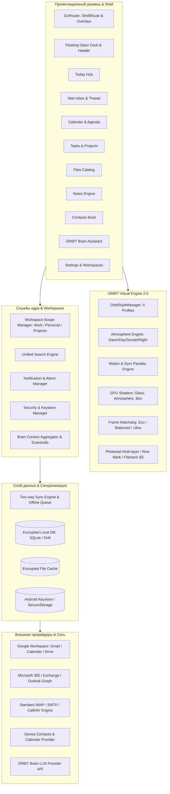

# Архитектура ORBIT: Текущее состояние и целевая экосистема
## Master Architecture Specification v1.0 (11.11.2026)

---

## 1. Введение и концепция системы

ORBIT — единая интеллектуальная цифровая экосистема для мобильных устройств, объединяющая электронную почту, календарь, задачи, файлы, заметки, контакты, рабочие пространства и персональный AI-слой (ORBIT Brain) в едином сверхплавном визуальном окружении нового поколения (Visual Engine 2.0).

В отличие от классических обособленных офисных клиентов (Gmail, Outlook, Todoist), ORBIT проектируется по принципу **сквозной объектной связности**:
- Письмо порождает задачу со ссылкой на исходный контекст.
- Задача планируется в календаре как блок времени встречи.
- К встрече прикрепляются документы из локального хранилища или облака.
- Контакты объединяют переписку, историю звонков и общие проекты.
- Все модули переключаются мгновенно без потери рабочего контекста через плавающий стек навигации и плавающую стеклянную док-панель.

---

## 2. Сравнение архитектурных уровней

| Архитектурный уровень | Текущее состояние (ORBIT 0.5.13+19) | Целевая архитектура (ORBIT Master Target) |
|---|---|---|
| **Корневая оболочка (App Shell)** | `GoRouter` + `StatefulShellRoute.indexedStack` (Today, Mail, Calendar, Tasks, Settings). Адаптивный glass dock / nav rail. | Модульный shell с поддержкой многооконности, deep links, глобального поиска, фонового жизненного цикла и виджетов рабочего стола. |
| **Слой данных (Data Layer)** | `OrbitAppState` (in-memory + JSON файл `orbit_state.json`), `OrbitSecureStore` для токенов. Демонстрационные данные `demo_data.dart`. | Локальная реляционная СУБД (SQLite / Drift с SQLCipher), версионируемые миграции схем, offline-first кэш, защищённое хранилище SecretStore. |
| **Синхронизация (Sync Engine)** | Однократная загрузка/сохранение JSON-снимка. Ручной retry при timeout. | Двунаправленный Sync Engine: очереди мутаций, разрешение конфликтов, экспоненциальный backoff, фоновый `WorkManager` Android. |
| **Почтовый движок (Mail Engine)** | Демо-список писем, чтение треда, локальный draft. | Провайдерная модель: Gmail API / OAuth 2.0, Microsoft Graph (M365/Outlook), IMAP/SMTP клиент, парсер MIME, кэш вложений. |
| **Календарный движок (Calendar Engine)** | Месячный стрип, локальные `DemoEvent`, добавление/редактирование в local state. | Двусторонняя синхронизация: Google Calendar, Microsoft Graph, CalDAV, локальный календарь устройства (Android CalendarProvider), рекуррентные события (RRULE). |
| **Задачи и проекты (Tasks & Projects)** | Локальные задачи, фильтры «Сегодня/Неделя/Проекты», чекбоксы, приоритеты. | Полноценная иерархия «Пространство → Проект → Список → Задача → Подзадача», дедлайны, теги, напоминания через AlarmManager. |
| **Рабочие пространства (Workspaces)** | Концептуальные бейджи в UI. | Физическая и логическая изоляция данных: Workspaces («Работа», «Личное», «Проекты»), привязка аккаунтов, фильтрация единого поиска. |
| **Файлы и документы (Files)** | Статические демо-вложения (PDF, XLSX). | Единый индекс вложений, кэш-менеджер, безопасный просмотр через FileProvider, интеграция с системным Storage Access Framework. |
| **Заметки и контакты (Notes & Contacts)** | Отсутствуют как выделенные модули. | Полноценные модули Notes (Markdown/RichText) и Contacts (локальная книга + чтение Android Contacts Provider по согласию). |
| **Интеллектуальный слой (ORBIT Brain)** | Mock-экран с правилами demo-ответов. | Локальный сбор контекста с маскированием ПДн, подключаемый LLM-провайдер, верифицированные инструменты (Tool Calling), режим подтверждения действий. |
| **Visual Engine 2.0** | 4 стиля (One, Atelier, Flow, Zen), 4 периода дня (Dawn/Day/Sunset/Night), процедурное небо + фотореалистичные слои + шейдеры Impeller + Rive/Filament fallback. | Аппаратный гиро-параллакс, динамический PBR-релайтинг, адаптивный watchdog (Eco/Balanced/Ultra), нулевой overhead для бизнес-логики. |

---

## 3. Подробная компонентная схема целевой системы

---

## 4. Архитектурные принципы и границы

### 4.1. Независимость UI от сетевых протоколов
Экранные виджеты (`TodayScreen`, `MailScreen`, etc.) общаются исключительно с абстрактными сервисами (`MailRepository`, `CalendarRepository`, `TasksRepository`) через реактивные потоки (Streams / ValueNotifiers). UI никогда не выполняет сетевые запросы напрямую и не знает о протоколе (REST, IMAP, Graph).

### 4.2. Безопасность и хранение секретов (Zero Cleartext)
- Токены OAuth 2.0 (Refresh / Access tokens) и пароли учетных записей хранятся исключительно через `OrbitSecretStore`, использующий Android Keystore (`EncryptedSharedPreferences` / `KeyStoreWrapper`).
- Никакие токены не попадают в JSON-файлы общего состояния или лог-файлы.
- Проверка сертификатов TLS/SSL всегда включена; self-signed сертификаты для частных серверов требуют явного подтверждения отпечатков пользователем.

### 4.3. Обособленность Visual Engine 2.0
- Графический конвейер работает как независимый фоновый слой (`OrbitSceneBackground`).
- Бизнес-логика, сохранение черновиков, учет задач и почты никогда не блокируются рендером или шейдерами.
- При просадке производительности ниже 30 FPS `OrbitFrameWatchdog` автоматически понижает визуальное качество до `Eco` / `Static`, сохраняя 60-120 FPS для списков и ввода текста.

### 4.4. Модульная организация Workspaces
- Каждая сущность в БД (письмо, событие, задача, заметка, контакт, файл) имеет обязательное поле `workspace_id` (`personal`, `work`, `projects`, либо `global`).
- При переключении пространства на уровне Shell все репозитории применяют локальный фильтр по `workspace_id`.
- Предусмотрен режим «Объединенный обзор», агрегирующий важные данные всех пространств на экране Today.

---

## 5. Стратегия миграции данных

1. **Фаза 1 (Текущая):** `orbit_state.json` сохраняет локальные задачи, черновик письма и настройки внешнего вида.
2. **Фаза 2 (Введение Drift/SQLite):** Добавление реляционной базы данных с параллельной синхронизацией. При первом запуске модуль `OrbitLocalStateMigrator` бесшовно переносит существующие задачи, события и черновики в SQLite без потери данных.
3. **Фаза 3 (Multi-Account):** Добавление таблиц аккаунтов, почтовых сообщений, папок, календарных сеток и истории задач с полной поддержкой внешних ключей и индексов полнотекстового поиска (FTS5).
