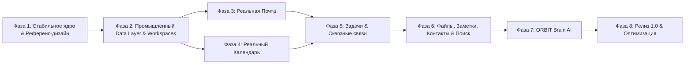

# Дорожная карта разработки ORBIT (Roadmap)
## Последовательность этапов, зависимости и контрольные точки (Master Specification v1.0)

---

## 1. Общая фазовая структура проекта

---

## 2. Детализация фаз и контрольных шлюзов (Quality Gates)

### Фаза 1. Стабильное ядро и эталонный интерфейс (Visual Engine 2.0 & Design Boards)
*Текущая активная фаза.*
- **Цель:** Полное визуальное и структурное соответствие приложения концепт-бордам (One, Atelier, Flow, Zen), стабильная навигация, единый `sceneKey` атмосферы, отсутствие артефактов на всех 5 языках и при масштабе шрифта до 200%.
- **Ключевые результаты:**
  - ✅ Экран Today: приветствие по времени суток, статус-карты, капсула даты, режимы Focus/Flow/Balance.
  - ✅ Upcoming Schedule: неоновые световые акценты, жирное время, секционная кнопка `(+)`.
  - ✅ Навигация: плавающий стеклянный док (`OrbitBottomNavigation`) со световой капсулой.
  - ✅ Quick Actions: модальный лист со сквирклами $2 \times 3$, контекстной AI-строкой и круглой кнопкой `(✕)`.
  - ✅ Tasks & Calendar: фильтры-капсулы «Сегодня/Неделя/Проекты», кастомные чекбоксы, светящийся FAB.
  - 🔄 Mail: фильтры «Входящие 12 / Важные / Все», круглые аватары, детальный просмотр с вложениями PDF/XLSX.
  - 🔄 Brain: неоновое кольцо, карточки подсказок, нижний аудио-визуализатор.
  - 🔄 Settings: превью-карточки стилей оформления.
- **Входной шлюз в следующую фазу (Gate 1):** 100% прохождение тестов, 0 замечаний `flutter analyze`, подтверждение сборки APK, визуальное совпадение с референсами.

---

### Фаза 2. Промышленное хранилище и рабочие пространства (Data Layer & Workspaces)
*Ближайшая архитектурная фаза.*
- **Цель:** Замена временного `orbit_state.json` на типизированную масштабируемую базу данных SQLite (Drift) с поддержкой миграций, внешних ключей и шифрования SQLCipher. Внедрение разделения на Workspaces («Работа», «Личное», «Проекты»).
- **Ключевые результаты:**
  - Модели сущностей БД: `workspaces`, `accounts`, `emails`, `events`, `tasks`, `attachments`, `notes`, `contacts`.
  - Модуль бесшовной миграции существующих данных пользователя без потерь.
  - Селектор пространств в UI с переключением области видимости репозиториев.
  - Защищенное хранилище токенов `OrbitSecretStore` на базе Android Keystore.
- **Входной шлюз (Gate 2):** Юнит-тесты миграций БД (round-trip), отсутствие потери созданных задач, время холодного старта базы данных < 100 мс.

---

### Фаза 3. Электронная почта реальных аккаунтов (Real Mail Engine)
- **Цель:** Превращение почтового модуля из демонстрационного в полноценный рабочий инструмент.
- **Ключевые результаты:**
  - Менеджер учетных записей (Gmail OAuth 2.0 PKCE, Microsoft Graph, IMAP/SMTP).
  - Почтовый клиент: получение папок, фоновая синхронизация, загрузка MIME, отправка с подтверждением.
  - Офлайн-очередь исходящих писем.
  - Безопасный кэш вложений и их открытие через системный `FileProvider`.
- **Требует участия пользователя:** Авторизация в учетных записях, выдача OAuth-разрешений.
- **Входной шлюз (Gate 3):** Успешная отправка и получение реального тестового письма на физическом устройстве.

---

### Фаза 4. Реальные календари и встречи (Real Calendar Engine)
- **Цель:** Полноценная двусторонняя синхронизация календарей.
- **Ключевые результаты:**
  - Адаптеры Google Calendar API, Microsoft 365 Calendar, CalDAV.
  - Чтение и запись системного Android CalendarProvider (при согласии пользователя).
  - Поддержка рекуррентных правил (RRULE), часовых поясов, напоминаний.
  - Интерактивная карточка встречи: участники, статусы участия, ссылки на онлайн-митинги.
- **Входной шлюз (Gate 4):** Создание встречи в ORBIT отображается во внешнем календаре; приглашения корректно принимаются/отклоняются.

---

### Фаза 5. Задачи, проекты и сквозные связи (Tasks & Cross-Entity Linking)
- **Цель:** Реализация ключевой ценности экосистемы — связанности информации.
- **Ключевые результаты:**
  - Древовидная иерархия задач, проектов и списков.
  - Действие «Создать задачу из письма» с сохранением двусторонней ссылки.
  - Действие «Запланировать задачу в календаре».
  - Привязка документов и контактов к задачам.
- **Входной шлюз (Gate 5):** Переход по ссылке из задачи точно открывает исходное письмо или встречу; целостность связей при удалении/архивации.

---

### Фаза 6. Файлы, заметки, контакты и единый поиск (Files, Notes, Contacts & Search)
- **Цель:** Формирование законченной персональной информационной среды.
- **Ключевые результаты:**
  - Экран `/files`: реестр документов, фильтрация по типам, поиск, предпросмотр.
  - Экран `/notes`: текстовый/Markdown редактор, автосохранение, офлайн-режим.
  - Экран `/contacts`: адресная книга, история взаимодействий.
  - Модуль глобального поиска Unified Search на SQLite FTS5 по всем типам данных.
- **Входной шлюз (Gate 6):** Поисковый запрос находит связанные письма, задачи и файлы за < 80 мс.

---

### Фаза 7. Интеллектуальный помощник ORBIT Brain (AI Assistant)
- **Цель:** Развертывание интеллектуального слоя поверх стабильной экосистемы.
- **Ключевые результаты:**
  - Контекстный шлюз с маскированием персональных данных и управлением согласием.
  - Подключение LLM (Gemini / OpenAI API) с потоковым ответом.
  - Tool Calling: генерация саммари писем, подготовка черновиков ответов, предложение расписания.
  - Guardrails: обязательное подтверждение пользователем любых действий, меняющих данные.
- **Входной шлюз (Gate 7):** Никакие неавторизованные действия не выполняются ИИ; точное соблюдение приватности.

---

### Фаза 8. Подготовка полноценного релиза 1.0 (Hardening & Release)
- **Цель:** Доведение продукта до уровня коммерческого релиза.
- **Ключевые результаты:**
  - Профилирование UI/GPU на Android HONOR: P95 < 11 мс (90/120 Гц), RAM < 220 МБ.
  - Полный аудит безопасности, шифрование БД, защита от утечек памяти.
  - Финализация локализации на 5 языков (RU, EN, DE, FR, ES).
  - Сборка подписанного релизного APK, генерация SHA-256 хэшей, верификация обновлений.
- **Входной шлюз (Gate 8):** Подписание акта комплексных приемочных испытаний.
